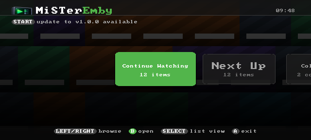
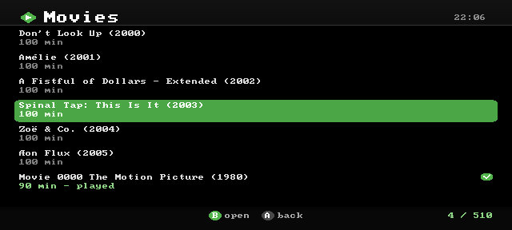
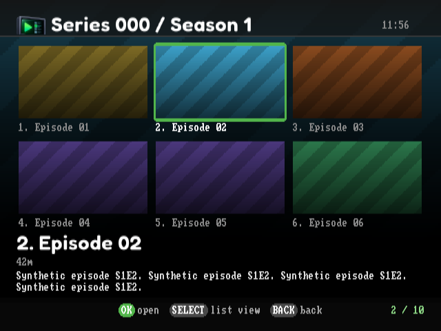
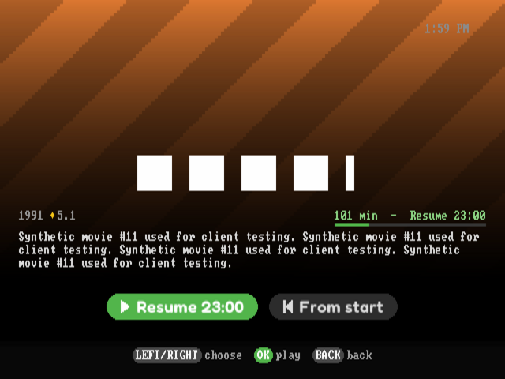
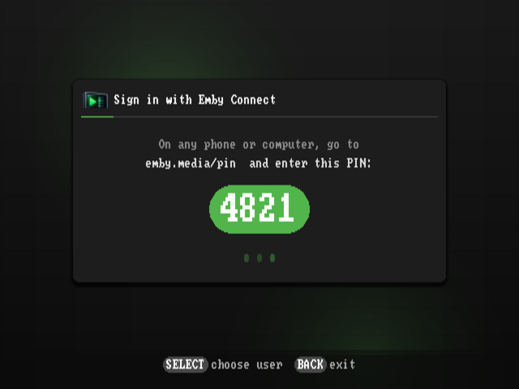
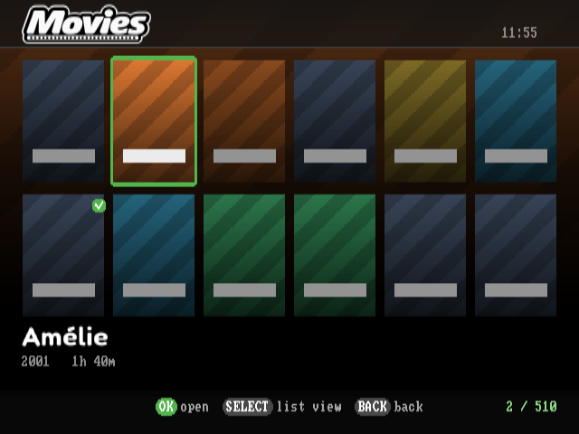
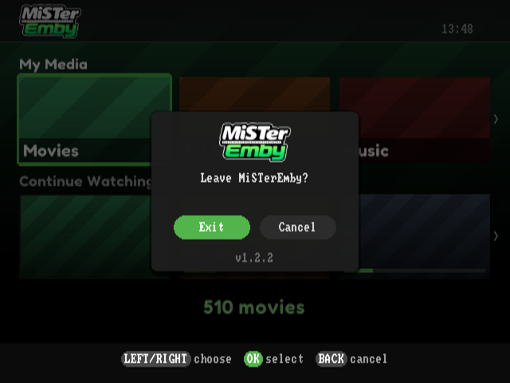
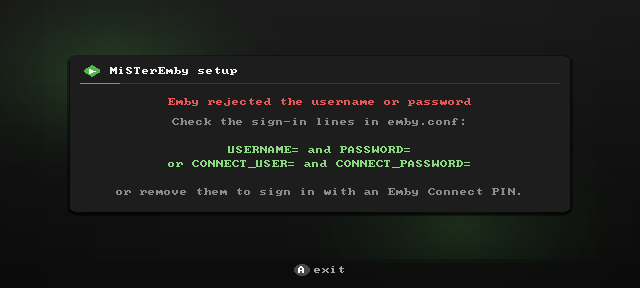
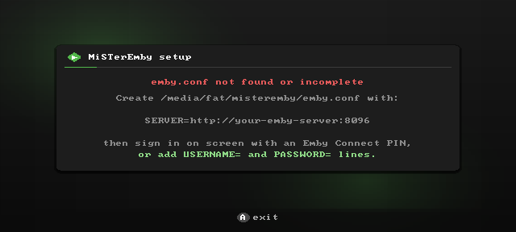

<p align="center"></p>

# MiSTerEmby

An [Emby](https://emby.media) client for the [MiSTer FPGA](https://misterfpga.org). Browse your Movies, TV, Music and Music Video libraries, see cover art and overviews, and play on a CRT. Video is transcoded by your Emby server and letterboxed to PAL or NTSC, with client-side subtitles, pause/seek/resume, and a music player with a now-playing screen and visualizers. It works with whatever analog output your MiSTer already uses (SCART, composite, component, VGA, HDMI), because it just draws to the standard MiSTer framebuffer.

MiSTerEmby is by **Chris Freeman ([freemchr](https://github.com/freemchr))**. It's a port of [MiSTerFin](https://github.com/puddingstudio/MiSTerFin) by [Pudding Studio](https://pudding.studio), customised for Emby: it keeps MiSTerFin's features and playback pipeline, talks to Emby's API with Emby's own sign-in methods, and has its own Emby-styled interface.

---

## Contents

- [Screenshots](#screenshots)
- [Features](#features)
- [Requirements](#requirements)
- [Installation](#installation)
  - [Installing and updating with MiSTer Downloader](#installing-and-updating-with-mister-downloader)
- [Configuring `emby.conf`](#configuring)
  - [Signing in](#signing-in)
- [Controls](#controls)
- [Building from source](#building)
  - [Running it on a desktop](#running-on-desktop)
- [Status and known limitations](#status)
- [Credits](#credits)
- [Licence](#licence)

---

## <a id="screenshots"></a>Screenshots

Rendered with `tools/run-local.sh` against the bundled mock server (`tools/mock-emby.py`), so the library content and cover art are synthetic placeholders.

| | | |
|:---:|:---:|:---:|
| <br>Home: library tiles | <br>Library list, played badge | <br>Episodes |
| <br>Info, resume progress | <br>Emby Connect PIN sign-in | <br>Poster view (next release) |
| <br>Exit dialog | <br>Sign-in error | <br>Setup help |

## <a id="features"></a>Features

- **Emby-style interface**: dark charcoal surfaces, Emby green for focus, progress and played state, rounded tiles and dialogs, button-chip hints along the bottom
- **Sign in without typing on a gamepad**: an **Emby Connect PIN** (enter it at emby.media/pin from any phone or computer). A local username/password, an Emby Connect account or an API key in `emby.conf` also work. The sign-in is saved, and a revoked one is detected and requested again
- **Continue Watching and Next Up** appear as the first home tiles when they have something in them
- **Home screen**: a row of library tiles (name and item count) over a dimmed mosaic of that library's covers. LEFT/RIGHT slides between them; SELECT swaps to a plain list
- **Browsing**: lists with cover art, played badges, resume progress bars, backdrop art behind the list, a live clock, and scrolling for long titles. Large libraries page in as you scroll
- **Info screen**: backdrop, logo, year, rating, overview, and Play/Resume buttons
- **Video playback**: server-side transcode to a light MPEG-4 stream the MiSTer can decode in real time, letterboxed or pillarboxed for any source aspect. True interlaced 480i/576i output is supported through the standalone interlaced core (see the [display guide](docs/DISPLAY_COMPATIBILITY.md#interlaced-output))
- **Track picker** (SELECT during playback): audio tracks, subtitles (text subtitles rendered client-side with live sync adjustment; image subtitles burned in by the server), and picture modes for wide titles (Original / Zoom 4:3 / Stretch)
- **Music**: Artists → Albums → Tracks, direct-play audio, a now-playing screen with real VU meters and selectable backgrounds (starfield, rain, Nebula, Now Spinning, Tunnel), seek, previous/next, auto-advance, and library shuffle
- **Sync with Emby**: resume positions and played state are read from and written back to Emby
- **Emby dashboard integration**: the session shows up with transcoding info; remote pause/play/stop and admin messages work (messages show as a green banner)
- **UI sounds**, a **SELECT+START screenshot** combo, an **opt-in debug log**, and an **in-app updater** from GitHub releases

### Coming in the next release

These are on the `main` branch but not in the v1.0.0 download yet, and haven't been tested on a MiSTer. They'll ship as v1.1.0 once they have been.

- **Poster view**: Movies, TV and Collections show as a wall of posters, and a season's episodes as a row of stills with the focused episode's synopsis below, the way Emby's TV apps lay them out. Art comes from the SD card cache and is scaled once, so it stays light on the MiSTer. SELECT swaps to the text list and back
- **Live TV and Recordings**: when the Emby server has Live TV set up (an M3U playlist works), a Live TV tile opens a menu of its TV sources and channel categories, each listing its channels with their logos; selecting one tunes straight in. A channel whose own stream comes in a size the MiSTer can decode (up to 640x360) plays directly, with no work for the server; others are converted by Emby (`LIVE_TRANSCODE` in `emby.conf` always converts). A Recordings tile lists finished recordings, which play like any other title. Live channels can be paused but not seeked
- **Collections**: a home tile for your Emby box sets, even if the server shows no Collections library
- **Skip intro and credits**: when Emby has detected a title's intro or credits, a "UP: Skip intro" / "UP: Skip credits" prompt appears at the right moment. Skipping the credits finishes the title and marks it played
- **Direct streaming for SD files**: DivX/Xvid, MPEG-1 and progressive MPEG-2 files play with their video untouched, so the Emby server only repackages them (`TRANSCODE_ALWAYS` in `emby.conf` turns this off)
- **Choose a user**: SELECT on the sign-in screen lists the server's users
- **Cinema Mode** (opt-in, `CINEMA_MODE` in `emby.conf`): trailers chosen by your Emby server's Cinema Mode settings play before a film started from the beginning; UP skips one

## <a id="requirements"></a>Requirements

- MiSTer FPGA with the standard Linux image and `menu.rbf`
- A way to get the picture onto your display. See the [display compatibility guide](docs/DISPLAY_COMPATIBILITY.md) for confirmed cable and `MiSTer.ini` combinations
- An Emby server the MiSTer can reach, and one way to sign in: an Emby Connect account linked to your Emby user (for the PIN), a username and password, or an API key
- `curl` on the MiSTer (included in the standard image)

## <a id="installation"></a>Installation

1. Copy these files from a release zip (or your own build) to `/media/fat/misteremby/` on the MiSTer:

   ```
   misteremby-arm
   mplayer-arm
   font/  subfont/  font2x/  subfont2x/
   sfx/
   emby.conf          (see below)
   ```

2. Copy the launcher, `tools/MiSTerEmby.sh`, to `/media/fat/Scripts/MiSTerEmby.sh`.
3. Launch **MiSTerEmby** from the MiSTer **Scripts** menu.

`make deploy` does steps 1 and 2 over SSH, except for `emby.conf`.

### Installing and updating with MiSTer Downloader

MiSTerEmby has its own database for MiSTer Downloader and update_all, so it can be installed and kept up to date with the rest of your MiSTer:

1. Copy [`downloader_misteremby.ini`](downloader_misteremby.ini) to `/media/fat/` on the SD card.
2. Run **downloader** or **update_all** from the Scripts menu. It installs `/media/fat/misteremby/` and `Scripts/MiSTerEmby.sh`.
3. Create `emby.conf` as described below. The database never installs or overwrites `emby.conf` or your saved sign-in.

If you use the database, update through the Downloader rather than the app's own updater (START when the home screen says an update is available). Both write the same files, so the next Downloader run would put back the version the database lists.

## <a id="configuring"></a>Configuring `emby.conf`

Create `/media/fat/misteremby/emby.conf`. The only line you need is your server's address:

```
SERVER=http://your-emby-server:8096
PAL
```

- **`PAL` / `NTSC`**: the TV mode. Optional; defaults to PAL.
- **Transcode profile**: optional, `WxH` or `WxH@BITRATE` (default `720x576@12000000`). Try `480x270@8000000` if a weak network makes playback stutter.
- **`DEBUGLOG`**: writes `/media/fat/misteremby/debug.log`, one line per request plus startup diagnostics. It never contains your server address, credentials, PIN, query strings, ids or titles, so it's safe to attach to an issue.
- **`INSECURE_TLS`**: skips certificate checks for an `https://` Emby server with a self-signed certificate. Emby Connect is always verified.

See [`emby.conf.example`](emby.conf.example) for every option, explained.

### <a id="signing-in"></a>Signing in

MiSTerEmby picks the first method your `emby.conf` allows:

1. **A saved sign-in** (`token.conf`, written after any successful sign-in). Delete it to sign out.
2. **Username and password**: `USERNAME=` and `PASSWORD=` lines, for a local Emby user.
3. **Emby Connect account**: `CONNECT_USER=` and `CONNECT_PASSWORD=` lines.
4. **API key**: `API_KEY=` and `USERNAME=` lines. The older three-line layout (server, key, username) also works.
5. **Choose a user** (next release): on the PIN screen, SELECT lists the server's users. Picking one without a password signs straight in, which is handy for a shared household server.
6. **Emby Connect PIN** (the default with just `SERVER=`): a PIN appears on screen. Go to **emby.media/pin** on any device, sign in to Emby Connect, and enter it. Your Emby user must be linked to that Emby Connect account (Emby: Settings → Users → your user → Emby Connect).

After the first sign-in works you can remove any password lines; the saved sign-in keeps working. `device.conf` holds a random id for this MiSTer. Don't copy it to a second MiSTer that signs in as the same user, or the two will keep signing each other out.

There's no on-screen keyboard, so edit `emby.conf` over SSH or on the SD card.

## <a id="controls"></a>Controls

Button names follow Xbox-style labels (bottom face button = A, right = B). On Nintendo-layout pads the positions are swapped. The bottom of every screen shows its buttons as chips, with the confirm button in green.

**SELECT+START** (held together, any screen) saves a screenshot to `/media/fat/screenshots/MiSTerEmby/`.

| Where | Button | Keyboard | Action |
|---|---|---|---|
| Home | Left / Right | Left / Right | Move between library tiles |
| Home | SELECT | Tab | Switch between tiles and list |
| Browse | Up / Down | Up / Down | Move |
| Browse | B | B / Enter / X | Open |
| Browse | A | A / Esc / Backspace / Z | Back (exit dialog at the top level) |
| Home | START | Pause / Home | When an update is available: its release notes, then B to install |
| Info | B | B / Enter / X | Play or resume |
| Info | SELECT | Tab | Play from the start (when there's a resume point) |
| Video | B | B / Enter / X | Pause / resume |
| Video | Left / Right | Left / Right | Seek 30s |
| Video | Up | Up | Skip intro / credits (while the prompt shows; next release) |
| Video | SELECT | Tab | Track picker |
| Video | L / R | PageUp / PageDown | VSync on / off |
| Video | A | Esc | Stop |
| Track picker | L / R | PageUp / PageDown | Switch tab |
| Track picker | Up / Down, Left / Right | arrows | Pick a track, adjust subtitle sync |
| Music | B / Left / Right / Up / Down | | Pause, seek 10s, previous / next track |
| Music | SELECT | Tab | Cycle background |

A keyboard works on its own, without a gamepad.

## <a id="building"></a>Building from source

You need [Zig](https://ziglang.org) 0.16 for the ARM cross-compile. `make deploy` also needs `sshpass`.

```bash
make arm                        # build misteremby-arm
make deploy                     # copy everything to the MiSTer (or: make deploy MISTER_HOST=192.168.x.x)
```

`mplayer-arm`, the video player, comes ready-built in the repo. It's MPlayer 1.5 with MiSTerEmby's patched framebuffer driver ([`mplayer/vo_fbdev.c`](mplayer/vo_fbdev.c)), the build that was tested on hardware, and it's what releases ship. You only need to rebuild it after changing that driver:

```bash
tools/build-mplayer.sh          # no Docker or root needed; uses Zig plus downloaded Debian packages
```

MPlayer is GPL-2.0-or-later; its corresponding source is the upstream 1.5 release plus that one driver file, built by that script.

`make test` runs the unit tests on the host. Pushing a `v*` tag builds a release zip through GitHub Actions (`.github/workflows/release.yml`), which is what the in-app updater downloads.

### <a id="running-on-desktop"></a>Running it on a desktop

`tools/run-local.sh` runs the real app on a Linux desktop. It draws into a memory buffer, reads keys from the terminal, and saves frames as PNGs. Video playback doesn't work this way; everything else does.

```bash
python3 tools/mock-emby.py 8096 &          # fake Emby server with a synthetic library
printf 'SERVER=http://127.0.0.1:8096\nUSERNAME=mockuser\nPASSWORD=mockpass\n' > emby.conf
tools/run-local.sh                         # interactive: arrows, Enter, Esc, Tab, q
tools/run-local.sh -k "right,a:1500" -o shot.png
```

To try the PIN flow against the mock, start the client with `MISTEREMBY_CONNECT_BASE=http://127.0.0.1:8096/connect/service` and only a `SERVER=` line. The mock confirms the PIN after a few polls.

`MISTEREMBY_INPUT_DEBUG=1` prints every input event to stderr, and also works on real hardware over SSH.

## <a id="status"></a>Status and known limitations

- **Tested on hardware** against Emby Server 4.10.1 on a Synology NAS (no hardware transcoding), with an HDMI-to-VGA adapter into a 31kHz CRT monitor at 640x480. Confirmed: Emby Connect PIN sign-in, the saved sign-in, browsing, Continue Watching and Next Up, full-screen playback, seek and pause, and resume positions syncing with Emby. Not yet tested: subtitles, switching audio tracks, music, and dashboard messages.
- **Emby has no MPEG-2 encoder**, so video is transcoded to MPEG-4 Part 2, the lightest codec Emby offers. A NAS without hardware transcoding manages about 1.2–1.9x real time from a 1080p H.264 source. That's enough for one stream; heavy load on the server can still stall playback.
- **Smooth motion depends on the refresh rate.** 25fps video on a 60Hz screen judders slightly. On a PC CRT, a 75Hz `[Menu]` mode in `MiSTer.ini` (`video_mode=640,16,64,120,480,1,3,16,31500`) shows every 25fps frame for exactly 3 refreshes.
- Burning in image-based subtitles (PGS/VobSub) needs the server to re-encode with the subtitle drawn in. Some Emby setups are known to fail burn-in transcodes. If a title with an image subtitle won't play, turn the subtitle off.
- Only the first media source (version) of a multi-version item is played.
- The command socket (remote control, admin messages) only works with `http://` servers. Everything else works over `https://`.
- The bitmap font covers Latin-1, so other scripts are transliterated or shown as `?`.
- If mplayer can't open a stream, you're returned to the browser without an error message.
- Live TV is transcoded like everything else, so a broadcast HD channel needs a server that can transcode it in real time. A NAS without hardware transcoding may not keep up.

## <a id="credits"></a>Credits

MiSTerEmby is a derivative of **[MiSTerFin](https://github.com/puddingstudio/MiSTerFin)** by **[Pudding Studio](https://pudding.studio)**, used under CC BY-NC 4.0. The framebuffer UI, playback pipeline, music visualizers, sounds and fonts are theirs, along with the work of MiSTerFin's contributors, including [Izzie Walton (@iwalton3)](https://github.com/iwalton3) and [Trent Nix (@trentnix)](https://github.com/trentnix).

MiSTerEmby's changes, by Chris Freeman (freemchr): the Emby API client and sign-in methods (password, Emby Connect, Emby Connect PIN), the Emby command socket, the MPEG-4 transcode path and buffering tuned for Emby, the Emby-styled interface, and the Docker-free MPlayer build.

Third-party components and their licences are listed in [docs/THIRD_PARTY.md](docs/THIRD_PARTY.md). Emby is a trademark of Emby LLC. MiSTerEmby is an independent project and isn't affiliated with or endorsed by Emby.

## <a id="licence"></a>Licence

[CC BY-NC 4.0](https://creativecommons.org/licenses/by-nc/4.0/), the same as MiSTerFin: free to use, share and modify, non-commercial only, with attribution. See [LICENSE](LICENSE).
