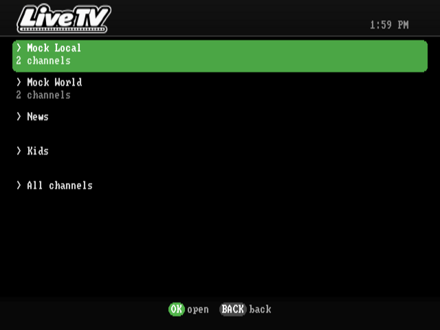
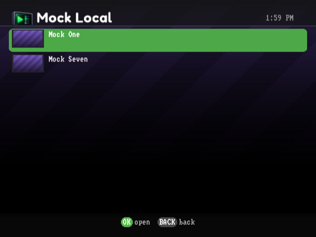

<p align="center"></p>

# MiSTerEmby

An [Emby](https://emby.media) client for the [MiSTer FPGA](https://misterfpga.org). Browse your Movies, TV, Music and Music Video libraries, see cover art and overviews, and play on a CRT. Video is transcoded by your Emby server and letterboxed to PAL or NTSC, with client-side subtitles, pause/seek/resume, and a music player with a now-playing screen and visualizers. It works with whatever analog output your MiSTer already uses (SCART, composite, component, VGA, HDMI), because it just draws to the standard MiSTer framebuffer.

MiSTerEmby is by **Chris Freeman ([freemchr](https://github.com/freemchr))**. It's a port of [MiSTerFin](https://github.com/puddingstudio/MiSTerFin) by [Pudding Studio](https://pudding.studio), customised for Emby: it keeps MiSTerFin's features and playback pipeline, talks to Emby's API with Emby's own sign-in methods, and has its own Emby-styled interface.

---

## Contents

- [Quick start](#quick-start)
- [Screenshots](#screenshots)
- [Features](#features)
- [Requirements](#requirements)
- [Installation](#installation)
  - [Installing and updating with MiSTer Downloader](#installing-and-updating-with-mister-downloader)
  - [Updating and uninstalling](#updating)
- [Configuring `emby.conf`](#configuring)
  - [Every setting](#settings)
  - [Signing in](#signing-in)
- [Setting up Live TV](#live-tv)
- [Getting the best picture](#picture)
- [Controls](#controls)
- [Troubleshooting](#troubleshooting)
- [Building from source](#building)
  - [Running it on a desktop](#running-on-desktop)
- [Status and known limitations](#status)
- [Credits](#credits)
- [Licence](#licence)

---

## <a id="quick-start"></a>Quick start

1. Download `misteremby-vX.Y.Z.zip` from [Releases](../../releases) and copy the `misteremby` folder inside it to `/media/fat/` on the SD card. (Or use [MiSTer Downloader](#installing-and-updating-with-mister-downloader).)
2. Copy `misteremby/MiSTerEmby.sh` from that folder to `/media/fat/Scripts/`.
3. Create `/media/fat/misteremby/emby.conf` with one line, your Emby server's address: `SERVER=http://192.168.x.x:8096`.
4. On the MiSTer, open **Scripts → MiSTerEmby**. A PIN appears: enter it at **emby.media/pin** on your phone, signed in to the Emby Connect account linked to your Emby user.
5. That's it — the sign-in is remembered. See [Getting the best picture](#picture) if you use a CRT.

## <a id="screenshots"></a>Screenshots

Rendered with `tools/run-local.sh` against the bundled mock server (`tools/mock-emby.py`), so the library content and cover art are synthetic placeholders. They are stretched to 4:3, the shape they have on a TV.

| | | |
|:---:|:---:|:---:|
| <br>Home: rows of artwork | <br>Poster view | <br>Episodes as stills |
| <br>Live TV: sources and categories | <br>Channels with logos | <br>Info screen |
| <br>Emby Connect PIN sign-in | <br>Exit dialog | <br>Setup help |

## <a id="features"></a>Features

- **Emby-style interface**: dark charcoal surfaces, Emby green for focus, progress and played state, rounded tiles and dialogs, button-chip hints along the bottom
- **Sign in without typing on a gamepad**: an **Emby Connect PIN** (enter it at emby.media/pin from any phone or computer). A local username/password, an Emby Connect account or an API key in `emby.conf` also work. The sign-in is saved, and a revoked one is detected and requested again
- **Home screen like Emby's TV apps**: rows of artwork — My Media (your libraries, Live TV, Recordings, Collections), Continue Watching (with progress bars, and the channels you watched last) and Next Up — centred on screen, with the focused title's backdrop behind it. UP/DOWN moves between rows, LEFT/RIGHT along one; SELECT swaps to a plain list
- **Poster view**: Movies, TV and Collections show as a wall of posters, and a season's episodes as a row of stills with the focused episode's synopsis, the way Emby's TV apps lay them out. SELECT swaps to the text list and back
- **Live TV and Recordings**: with Live TV set up on the Emby server (an M3U playlist works), Live TV opens a menu of its TV sources and channel categories, each listing its channels with their logos; selecting one tunes straight in, and A cancels while it tunes. A channel whose own stream comes in a size the MiSTer can decode (up to 640x360) plays directly, with no work for the server; others are converted by Emby, at a lighter profile so a NAS keeps up (`LIVE_TRANSCODE` in `emby.conf` always converts). Recordings play like any other title. Live channels can be paused but not seeked
- **Browsing**: lists with cover art, played badges, resume progress bars, backdrop art behind the list, a live clock, and scrolling for long titles. Large libraries page in as you scroll. Collections lists your Emby box sets even if the server shows no Collections library
- **Info screen**: backdrop, logo, year, rating, overview, and Play/Resume buttons
- **Video playback**: server-side transcode to a light MPEG-4 stream the MiSTer can decode in real time, letterboxed or pillarboxed for any source aspect. SD DivX/Xvid, MPEG-1 and progressive MPEG-2 files stream with their video untouched, so the server only repackages them (`TRANSCODE_ALWAYS` turns this off). True interlaced 480i/576i output is supported through the standalone interlaced core (see the [display guide](docs/DISPLAY_COMPATIBILITY.md#interlaced-output))
- **Skip intro and credits**: when Emby has detected a title's intro or credits (Emby's intro detection), a "UP: Skip intro" / "UP: Skip credits" prompt appears at the right moment. Skipping the credits finishes the title and marks it played
- **Cinema Mode** (opt-in, `CINEMA_MODE` in `emby.conf`): trailers chosen by your Emby server's Cinema Mode settings play before a film started from the beginning; UP skips one
- **Track picker** (SELECT during playback): audio tracks, subtitles (text subtitles rendered client-side with live sync adjustment; image subtitles burned in by the server), and picture modes for wide titles (Original / Zoom 4:3 / Stretch)
- **Music**: Artists → Albums → Tracks, direct-play audio, a now-playing screen with real VU meters and selectable backgrounds (starfield, rain, Nebula, Now Spinning, Tunnel), seek, previous/next, auto-advance, and library shuffle
- **Sync with Emby**: resume positions and played state are read from and written back to Emby
- **Emby dashboard integration**: the session shows up with transcoding info; remote pause/play/stop and admin messages work (messages show as a green banner)
- **Its own look**: the MiSTerEmby logo and section titles, a rounded display font (Fredoka) for the big text, an Emby-green loading ring, and a green badge in the top bar when an update is out
- **UI sounds**, a **SELECT+START screenshot** combo, an **opt-in debug log**, and an **in-app updater** from GitHub releases (START when the update badge shows)

## <a id="requirements"></a>Requirements

- MiSTer FPGA with the standard Linux image and `menu.rbf`
- A way to get the picture onto your display. See the [display compatibility guide](docs/DISPLAY_COMPATIBILITY.md) for confirmed cable and `MiSTer.ini` combinations
- An Emby server the MiSTer can reach, and one way to sign in: an Emby Connect account linked to your Emby user (for the PIN), a username and password, or an API key
- `curl` on the MiSTer (included in the standard image)

## <a id="installation"></a>Installation

1. Copy the `misteremby` folder from a release zip to `/media/fat/` on the MiSTer, so you have:

   ```
   /media/fat/misteremby/misteremby-arm       the app
   /media/fat/misteremby/mplayer-arm          its video player (included, nothing else to install)
   /media/fat/misteremby/font/ subfont/ font2x/ subfont2x/ sfx/
   /media/fat/misteremby/MiSTerEmby.sh        the launcher
   /media/fat/misteremby/emby.conf.example    every setting, explained
   ```

2. Copy the launcher, `misteremby/MiSTerEmby.sh`, to `/media/fat/Scripts/MiSTerEmby.sh`.
3. Create `/media/fat/misteremby/emby.conf` (see [below](#configuring)).
4. Launch **MiSTerEmby** from the MiSTer **Scripts** menu.

From a source checkout, `make deploy` does steps 1 and 2 over SSH.

### Installing and updating with MiSTer Downloader

MiSTerEmby has its own database for MiSTer Downloader and update_all, so it can be installed and kept up to date with the rest of your MiSTer:

1. Copy [`downloader_misteremby.ini`](downloader_misteremby.ini) to `/media/fat/` on the SD card.
2. Run **downloader** or **update_all** from the Scripts menu. It installs `/media/fat/misteremby/` and `Scripts/MiSTerEmby.sh`.
3. Create `emby.conf` as described below. The database never installs or overwrites `emby.conf` or your saved sign-in.

If you use the database, update through the Downloader rather than the app's own updater (START when the home screen says an update is available). Both write the same files, so the next Downloader run would put back the version the database lists.

### <a id="updating"></a>Updating and uninstalling

- **Updating**: when a new release is out, a green badge with its version appears next to the clock on the home screen. Press START to read what's new, then OK to install, and restart MiSTerEmby. Your `emby.conf` and sign-in are kept. (If you installed with MiSTer Downloader, update with that instead.)
- **Uninstalling**: delete `/media/fat/misteremby/` and `/media/fat/Scripts/MiSTerEmby.sh`, plus `downloader_misteremby.ini` if you added it. Nothing else on the SD card is changed, apart from any `MiSTer.ini` lines you added yourself.

## <a id="configuring"></a>Configuring `emby.conf`

Create `/media/fat/misteremby/emby.conf`. The only line you need is your server's address:

```
SERVER=http://your-emby-server:8096
PAL
```

- **`PAL` / `NTSC`**: the TV mode. Optional; defaults to PAL.
- **Transcode profile**: optional, `WxH` or `WxH@BITRATE` (default `720x576@12000000`). Try `480x270@8000000` if a weak network makes playback stutter.
- **`DEBUGLOG`**: writes `/media/fat/misteremby/debug.log`, one line per request plus startup diagnostics. It never contains your server address, credentials, PIN, query strings, ids or titles, so it's safe to attach to an issue.
- **`INSECURE_TLS`**: skips certificate checks for an `https://` Emby server with a self-signed certificate. Emby Connect is always verified.

See [`emby.conf.example`](emby.conf.example) for every option, explained.

### <a id="settings"></a>Every setting

Settings are one per line. Names aren't case-sensitive; lines starting with `#` are ignored.

| Setting | What it does |
|---|---|
| `SERVER=http://host:8096` | Your Emby server's address. **Required.** A trailing `/emby` is fine. |
| `PAL` or `NTSC` | The TV mode (default PAL). Use NTSC for a 60Hz/VGA-style setup. |
| `WxH` or `WxH@BITRATE` | The size and bitrate Emby converts video to (default `720x576@12000000`). Lower it, e.g. `480x270@8000000`, if the network or server struggles. |
| `USERNAME=` / `PASSWORD=` | Sign in as a local Emby user. |
| `CONNECT_USER=` / `CONNECT_PASSWORD=` | Sign in with an Emby Connect account, without the PIN. |
| `API_KEY=` / `USERNAME=` | Sign in with an Emby API key (made in the dashboard under Advanced → API Keys). |
| `MATCH_REFRESH` | Switch the display to a whole multiple of a film's frame rate while it plays (e.g. 71.93Hz for a 23.976fps film on a 75Hz screen), then back. Needs a custom `video_mode` in the `[Menu]` section of `MiSTer.ini` — see [Getting the best picture](#picture). |
| `CINEMA_MODE` | Play the trailers chosen by Emby's Cinema Mode before a film started from the beginning. |
| `TRANSCODE_ALWAYS` | Always have Emby convert video, never stream SD files untouched. |
| `LIVE_TRANSCODE` | Always have Emby convert Live TV, never play a channel's own stream directly. |
| `DEBUGLOG` | Write `debug.log` (and `mplayer.log`) next to `emby.conf` for troubleshooting. Safe to share: no addresses, credentials, ids or titles. |
| `INSECURE_TLS` | Accept a self-signed certificate on an `https://` Emby server. |

### <a id="signing-in"></a>Signing in

MiSTerEmby picks the first method your `emby.conf` allows:

1. **A saved sign-in** (`token.conf`, written after any successful sign-in). Delete it to sign out.
2. **Username and password**: `USERNAME=` and `PASSWORD=` lines, for a local Emby user.
3. **Emby Connect account**: `CONNECT_USER=` and `CONNECT_PASSWORD=` lines.
4. **API key**: `API_KEY=` and `USERNAME=` lines. The older three-line layout (server, key, username) also works.
5. **Choose a user**: on the PIN screen, SELECT lists the server's users. Picking one without a password signs straight in, which is handy for a shared household server.
6. **Emby Connect PIN** (the default with just `SERVER=`): a PIN appears on screen. Go to **emby.media/pin** on any device, sign in to Emby Connect, and enter it. Your Emby user must be linked to that Emby Connect account (Emby: Settings → Users → your user → Emby Connect).

After the first sign-in works you can remove any password lines; the saved sign-in keeps working. `device.conf` holds a random id for this MiSTer. Don't copy it to a second MiSTer that signs in as the same user, or the two will keep signing each other out.

There's no on-screen keyboard, so edit `emby.conf` over SSH or on the SD card.

## <a id="live-tv"></a>Setting up Live TV

Live TV comes from your Emby server, so it's set up there, once:

1. In the Emby dashboard go to **Live TV → TV Sources → Add**, and pick **M3U Tuner** for an IPTV playlist (or your tuner, such as an HDHomeRun). For free channels, [iptv-org](https://github.com/iptv-org/iptv) publishes playlists by country, e.g. `https://iptv-org.github.io/iptv/countries/au.m3u`.
2. Optionally add a TV guide (XMLTV) under **TV Guide Data Providers**, so channels show what's on now.
3. Live TV may need an Emby Premiere subscription; the dashboard will say.

MiSTerEmby then shows a **Live TV** tile. It opens a menu with one entry per TV source, then the playlists' categories (News, Sports, Kids, ...), then all channels. Pick a channel and it tunes in; BACK cancels while it's tuning.

**How a channel plays:**

- **Direct**: when the channel's own stream comes in a size the MiSTer can decode itself (640x360 or smaller, unencrypted), MiSTerEmby plays it straight from the internet. It starts in a second or two and the server does nothing.
- **Through the server**: anything else (HD-only streams, or hosts that refuse direct access) is converted by Emby, at a lighter profile so a NAS keeps up. `LIVE_TRANSCODE` makes every channel go this way.

The last three channels you watched appear at the start of Continue Watching.

## <a id="picture"></a>Getting the best picture

- **Your display**: MiSTerEmby draws to the normal MiSTer framebuffer, so it works with whatever output your MiSTer uses. The [display compatibility guide](docs/DISPLAY_COMPATIBILITY.md) lists confirmed cable and `MiSTer.ini` combinations.
- **PC CRT monitors (31kHz VGA)**: give the menu a custom mode in `MiSTer.ini`, which then also applies to MiSTerEmby. For example, VESA 640x480 at 75Hz:

  ```ini
  [Menu]
  video_mode=640,16,64,120,480,1,3,16,31500
  ```

  The last number is the pixel clock in kHz (`31500`, not `31.5`). At 75Hz, 25fps video shows every frame for exactly three refreshes.
- **Smooth films**: add `MATCH_REFRESH` to `emby.conf` and MiSTerEmby re-times that mode to suit each title — 71.93Hz for 23.976fps films, 59.94Hz for 29.97fps — keeping the line rate the monitor locks to, and switches back when the film ends. Your monitor's on-screen display should show the change. Leave it off on a TV or HDMI display that doesn't like mode changes.
- **Stutter**: if it's the server (a NAS without hardware transcoding can only just keep up with HD), lower the transcode profile; if it's the network, the same. `debug.log` records how each title was played.

## <a id="controls"></a>Controls

Button names follow Xbox-style labels (bottom face button = A, right = B). On Nintendo-layout pads the positions are swapped. The bottom of every screen shows its buttons as chips, named for what they do: **OK** (the confirm button, B, in green) and **BACK** (A).

**SELECT+START** (held together, any screen) saves a screenshot to `/media/fat/screenshots/MiSTerEmby/`.

| Where | Button | Keyboard | Action |
|---|---|---|---|
| Home | Up / Down | Up / Down | Move between rows |
| Home | Left / Right | Left / Right | Move along a row |
| Home | SELECT | Tab | Switch between rows and a plain list |
| Browse | Up / Down | Up / Down | Move |
| Poster view | arrows, L / R | arrows, PageUp / PageDown | Move by poster and row; a screenful |
| Poster view | SELECT | Tab | Switch to the text list and back |
| Live TV | A | Esc | Cancel while a channel is tuning in |
| Browse | B | B / Enter / X | Open |
| Browse | A | A / Esc / Backspace / Z | Back (exit dialog at the top level) |
| Home | START | Pause / Home | When the update badge shows: its release notes, then OK to install |
| Info | B | B / Enter / X | Play or resume |
| Info | SELECT | Tab | Play from the start (when there's a resume point) |
| Video | B | B / Enter / X | Pause / resume |
| Video | Left / Right | Left / Right | Seek 30s |
| Video | Up | Up | Skip intro / credits / a Cinema Mode trailer (while the prompt shows) |
| Video | SELECT | Tab | Track picker |
| Video | L / R | PageUp / PageDown | VSync on / off |
| Video | A | Esc | Stop |
| Track picker | L / R | PageUp / PageDown | Switch tab |
| Track picker | Up / Down, Left / Right | arrows | Pick a track, adjust subtitle sync |
| Music | B / Left / Right / Up / Down | | Pause, seek 10s, previous / next track |
| Music | SELECT | Tab | Cycle background |

A keyboard works on its own, without a gamepad.

## <a id="building"></a>Building from source

You need [Zig](https://ziglang.org) 0.16 for the ARM cross-compile. `make deploy` also needs `sshpass`.

```bash
make arm                        # build misteremby-arm
make deploy                     # copy everything to the MiSTer (or: make deploy MISTER_HOST=192.168.x.x)
```

`mplayer-arm`, the video player, comes ready-built in the repo. It's MPlayer 1.5 with MiSTerEmby's patched framebuffer driver ([`mplayer/vo_fbdev.c`](mplayer/vo_fbdev.c)), the build that was tested on hardware, and it's what releases ship. You only need to rebuild it after changing that driver:

```bash
tools/build-mplayer.sh          # no Docker or root needed; uses Zig plus downloaded Debian packages
```

MPlayer is GPL-2.0-or-later; its corresponding source is the upstream 1.5 release plus that one driver file, built by that script.

`make test` runs the unit tests on the host. Pushing a `v*` tag builds a release zip through GitHub Actions (`.github/workflows/release.yml`), which is what the in-app updater downloads.

### <a id="running-on-desktop"></a>Running it on a desktop

`tools/run-local.sh` runs the real app on a Linux desktop. It draws into a memory buffer, reads keys from the terminal, and saves frames as PNGs. Video playback doesn't work this way; everything else does.

```bash
python3 tools/mock-emby.py 8096 &          # fake Emby server with a synthetic library
printf 'SERVER=http://127.0.0.1:8096\nUSERNAME=mockuser\nPASSWORD=mockpass\n' > emby.conf
tools/run-local.sh                         # interactive: arrows, Enter, Esc, Tab, q
tools/run-local.sh -k "right,a:1500" -o shot.png
```

To try the PIN flow against the mock, start the client with `MISTEREMBY_CONNECT_BASE=http://127.0.0.1:8096/connect/service` and only a `SERVER=` line. The mock confirms the PIN after a few polls.

`MISTEREMBY_INPUT_DEBUG=1` prints every input event to stderr, and also works on real hardware over SSH.

## <a id="troubleshooting"></a>Troubleshooting

| Problem | What to try |
|---|---|
| "emby.conf not found or incomplete" | Create `/media/fat/misteremby/emby.conf` with a `SERVER=` line. |
| "Can't connect to server" | Check the address works in a browser on the same network. Right after power-on the MiSTer waits up to 20 seconds for the network. For `https://` with a self-signed certificate, add `INSECURE_TLS`. |
| The PIN sign-in fails | The PIN expires after a few minutes; press OK for a new one. Your Emby user must be linked to that Emby Connect account (Emby: Settings → Users → your user → Emby Connect). Or sign in with `USERNAME=`/`PASSWORD=`. |
| Signed in as the wrong user | Delete `token.conf` next to `emby.conf`, or use SELECT on the sign-in screen to pick a user. |
| A title won't play, or drops back | Turn on `DEBUGLOG`, try again, and look at `debug.log` and `mplayer.log`. Image subtitles (PGS/VobSub) need the server to burn them in; turn the subtitle off if a title with one won't start. |
| A channel won't tune | Many free IPTV streams are dead or geo-blocked; try another. `mplayer.log` (with `DEBUGLOG`) shows what the stream answered. |
| Video stutters | See [Getting the best picture](#picture). |
| "Press any key to continue" after exiting | MiSTerEmby reloads the menu on exit to skip it. To keep the old behaviour, create an empty file `/media/fat/misteremby/keep-script-prompt`. |

Files MiSTerEmby keeps next to `emby.conf`: `token.conf` (the saved sign-in), `device.conf` (this MiSTer's id), `recent_channels.txt`, `covercache/` and `gridcache/` (artwork; safe to delete), and `debug.log`/`mplayer.log` when `DEBUGLOG` is on.

## <a id="status"></a>Status and known limitations

- **Tested on hardware** against Emby Server 4.10.1 on a Synology NAS (no hardware transcoding), with an HDMI-to-VGA adapter into a 31kHz CRT monitor at 640x480. Confirmed: Emby Connect PIN sign-in, the saved sign-in, the home rows, poster view and browsing, full-screen playback, seek and pause, resume positions syncing with Emby, and Live TV from IPTV (M3U) playlists — both played directly on the MiSTer and converted by the server. Not yet tested on hardware: subtitles, switching audio tracks, music, dashboard messages, skip intro (needs Emby's intro detection), Cinema Mode, choosing a user, and direct streaming of SD files.
- **Emby has no MPEG-2 encoder**, so video is transcoded to MPEG-4 Part 2, the lightest codec Emby offers. A NAS without hardware transcoding manages about 1.2–1.9x real time from a 1080p H.264 source. That's enough for one stream; heavy load on the server can still stall playback.
- **Smooth motion depends on the refresh rate.** 25fps video on a 60Hz screen judders slightly. On a PC CRT, a 75Hz `[Menu]` mode in `MiSTer.ini` (`video_mode=640,16,64,120,480,1,3,16,31500`) shows every 25fps frame for exactly 3 refreshes.
- Burning in image-based subtitles (PGS/VobSub) needs the server to re-encode with the subtitle drawn in. Some Emby setups are known to fail burn-in transcodes. If a title with an image subtitle won't play, turn the subtitle off.
- Only the first media source (version) of a multi-version item is played.
- The command socket (remote control, admin messages) only works with `http://` servers. Everything else works over `https://`.
- The bitmap font covers Latin-1, so other scripts are transliterated or shown as `?`.
- If mplayer can't open a stream, you're returned to the browser without an error message.
- Live TV channels that only offer HD streams (or refuse direct access) are converted by the server in real time; a NAS without hardware transcoding manages about 1.2x real time on a 720p channel, which is enough but can jitter under load. Channel lists have no programme names unless Emby has guide data (XMLTV) for them.

## <a id="credits"></a>Credits

MiSTerEmby is a derivative of **[MiSTerFin](https://github.com/puddingstudio/MiSTerFin)** by **[Pudding Studio](https://pudding.studio)**, used under CC BY-NC 4.0. The framebuffer UI, playback pipeline, music visualizers, sounds and fonts are theirs, along with the work of MiSTerFin's contributors, including [Izzie Walton (@iwalton3)](https://github.com/iwalton3) and [Trent Nix (@trentnix)](https://github.com/trentnix).

MiSTerEmby's changes, by Chris Freeman (freemchr): the Emby API client and sign-in methods (password, Emby Connect, Emby Connect PIN), the Emby command socket, the MPEG-4 transcode path and buffering tuned for Emby, the Emby-styled interface, and the Docker-free MPlayer build.

Third-party components and their licences are listed in [docs/THIRD_PARTY.md](docs/THIRD_PARTY.md). Emby is a trademark of Emby LLC. MiSTerEmby is an independent project and isn't affiliated with or endorsed by Emby.

## <a id="licence"></a>Licence

[CC BY-NC 4.0](https://creativecommons.org/licenses/by-nc/4.0/), the same as MiSTerFin: free to use, share and modify, non-commercial only, with attribution. See [LICENSE](LICENSE).
